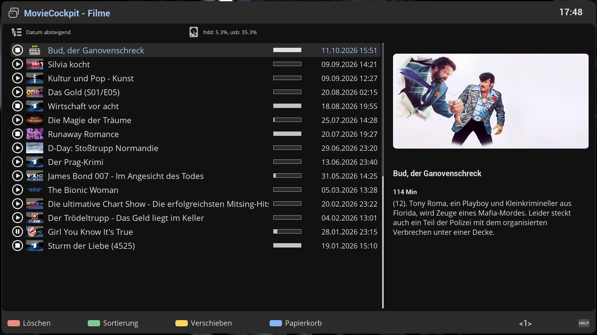

# MovieCockpit (MVC)

MovieCockpit is a movie list for Enigma2 set-top boxes (OpenViX and compatible images). It replaces the
standard movie list that opens when you press **PVR / VIDEO** in TV mode, and keeps everything it
knows about your recordings in a permanent SQLite cache, so the list appears at once, without waiting
for a disk to spin up.

This wiki describes version **0.19.1**.

## What it does

- **Instant list.** Names, times, lengths, descriptions, covers and playback progress come from the cache,
  not from the disks. See [Cache Database](Cache-Database.md).
- **Several disks as one library.** Every Enigma2 movie directory (hdd, usb, sd card, NAS) is merged into one
  view. NAS shares that are switched off are hidden and come back when they are reachable again.
  See [Storage and Network](Storage-and-Network.md).
- **Exact event times.** The list shows when the programme really started and how long it really lasted,
  not the recording start and length with their safety margins. See [Covers and Metadata](Covers-and-Metadata.md).
- **Smart jump.** The bouquet keys skip commercials in steps that shrink as you home in on the end of
  the break. See [Playback](Playback.md).
- **Series folders.** New recordings are filed into the matching series folder automatically.
  See [Managing Recordings](Managing-Recordings.md).
- **Trashcan, move, copy and archive.** File operations run as background jobs with a progress screen.
  Finished recordings can be archived from an internal disk to a backup disk.
- **Covers.** A cover per recording or per folder, with automatic download from several TV sources.
- **Configurable look.** Colours, date format, directory information and sort order are all settings.
  See [Settings](Settings.md) and [Skinning](Skinning.md).

## Pages

| Page | For | Content |
|---|---|---|
| [Installation](Installation.md) | everyone | Requirements, installing, first start, removal |
| [User Guide](User-Guide.md) | everyone | The list screen, icons, list modes, selecting, details |
| [Keys and Buttons](Keys-and-Buttons.md) | everyone | Every key, long press and colour-button level |
| [Playback](Playback.md) | everyone | Resume, start position, smart jump, progress |
| [Managing Recordings](Managing-Recordings.md) | everyone | Delete, trashcan, move, copy, series folders, archive |
| [Covers and Metadata](Covers-and-Metadata.md) | everyone | Covers, where the data comes from, TMDB and Mediathek |
| [Storage and Network](Storage-and-Network.md) | everyone | Bookmarks, several disks, NAS shares |
| [Settings](Settings.md) | everyone | Every setting, its default and its effect |
| [Troubleshooting](Troubleshooting.md) | everyone | Common problems, logging, known limitations |
| [Cache Database](Cache-Database.md) | advanced | What is stored, when it is refreshed, reloading |
| [Skinning](Skinning.md) | skinners | Screens, widgets, list row layout |
| [Architecture](Architecture.md) | developers | Components, file map, data flow |

## Related plugins

MovieCockpit is the visible part of a small family. The others are installed as dependencies or are optional:

| Plugin | Role |
|---|---|
| CacheCockpit (CAC) | The SQL cache and the file manager behind the list |
| MountCockpit (MNC) | Bookmarks, mount points, NAS availability, free space |
| JobCockpit (JOC) | Job manager that runs file operations in the background |
| ComponentsCockpit (COC) | Skin converters, renderers and sources |
| FontCockpit | Fonts used by the skin |
| CoverCockpit (COV) | Cover download (optional, install separately) |
| TMDBCockpit, MediathekCockpit | Movie info and Mediathek download from the info screen (optional) |
| PowerCockpit (POC) | Finishes recordings and jobs before powering off; cleans the trashcan and archives at shutdown (optional) |

## Licence

GNU General Public License v3.0 or later. Copyright 2018-2026 by xcentaurix.
